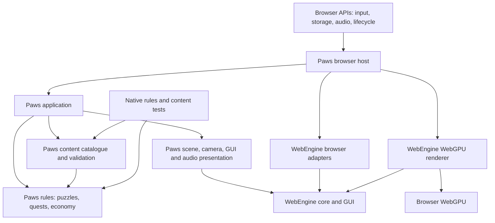
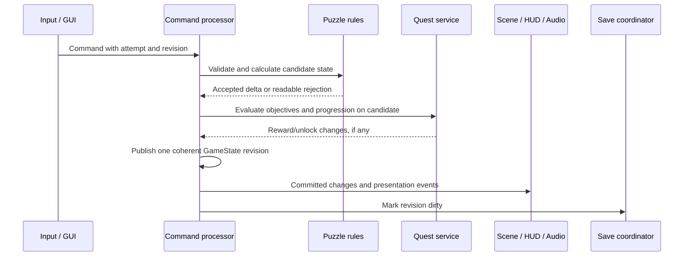

# Paws architecture

Status: proposed application architecture, 10 October 2026.

Paws is a single-player 3D garden puzzle game delivered as a website. One C++20 game implementation runs through WebAssembly in browsers on Windows PCs, Macs, iPhones and Android phones. WebEngine supplies the scene graph, rendering and browser integration; Paws supplies puzzle rules, quests, characters, progression and content.

The design follows [paws-concept.md](paws-concept.md). Start with quests 1, 6 and 7, then grow the catalogue through shared puzzle capabilities and handcrafted layouts. A quest should normally take two to five minutes. The garden is the persistent home where cats, earned friendship and purchased furnishings give those small puzzles continuity.

This document describes intended Paws gameplay systems. Phase 1 delivers portable puzzle rules and scene projection. Phases 5 and 6 deliver the authored courtyard, three ordered requests, independent saved attempts, shape/reachability/switch/gate rules, once-only rewards and IndexedDB restoration through `Afternoon`. Phase 7 adds shop transactions, owned furnishing placement/free moves, bounded cat use and the ending record. See [the garden/save contract](docs/phase5-garden-loop.md), [three-puzzle contract](docs/phase6-puzzles.md) and [phase-7 contract](docs/phase7-shop-garden.md), including its remaining animation art gate. Phase 8 delivers coalesced saves, bounded history, validated file recovery, tab ownership and composed lifecycle suspension; see [the durable save contract](docs/phase8-saves.md). See [delivered integration architecture](docs/architecture.md) and [implementation status](docs/implementation-status.md) for current contracts and scoped evidence. Existing engine capabilities were inspected in the checked-out submodule `external/WebEngine` at commit `3fe7d1dc1dc610c703944803cbb717cd65024ec9`. Engine documentation and source establish current contracts; earlier engine test results do not establish Paws acceptance.

## 1. Architectural decisions

| Decision | Reason |
| --- | --- |
| Keep Paws in this repository and pin WebEngine as a Git submodule | Game changes and engine upgrades have independent ownership and review. |
| Use a browser-hosted Wasm application with the existing WebGPU backend | Reuses WebEngine across the requested platforms without separate native game implementations. |
| Make puzzle rules a portable C++ library with no browser, renderer or scene dependency | Rules can be tested and replayed without a GPU, and their outcome cannot depend on frame rate. |
| Use discrete logical moves and authored connection graphs | Sliding, rolling, matching and water routes stay predictable on touch screens. |
| Use engine actors/components as the presentation and interaction binding | Reuses handles, prefabs, selection, animation and resource lifetimes. |
| Store compact game state and rebuild scenes from versioned content | Avoids saving meshes, textures, callbacks and temporary animation state with every move. |
| Use one active 3D scene at a time | Fits the engine runtime and constrains mobile memory. |
| Use the engine GUI for game menus and HUD; HTML for browser-level startup and recovery | Gives the game one UI model while keeping failure messages available before Wasm or GPU startup succeeds. |
| Ship single-threaded initially | Matches the engine and avoids making cross-origin isolation or worker scheduling a release prerequisite. |
| Ship local progression first | A static HTTPS deployment is sufficient; accounts, cloud saves, multiplayer and payments are separate future requirements. |

## 2. Browser support and compatibility boundary

The target is current, stable browsers with usable WebAssembly and WebGPU. An operating-system name alone does not establish support. Adapter acquisition, required device limits, shader compilation and rendering must succeed on the actual device.

| Platform | Primary release test target | Compatibility policy |
| --- | --- | --- |
| Windows PC | Current Chrome and Edge on integrated and discrete GPUs | Test mouse, keyboard, resize and browser zoom. Add Firefox to the supported matrix only after the same acceptance flows pass. |
| Mac | Current Safari on macOS 26 or later, plus current Chrome | Test Apple Silicon and an Intel Mac where the browser exposes a working adapter. Safari version alone is insufficient on older macOS. |
| iPhone | Safari on iOS 26 or later | Test real phones, ordinary tabs and Home Screen launch if offered. Other iPhone browsers require separate verification. |
| Android | Current Chrome on supported Android/GPU combinations | Test at least one Qualcomm Adreno and one ARM Mali device, including a lower-performance phone. Expand browser coverage from measured evidence. |

Safari 26 introduced WebGPU, but WebKit's clarification sets its OS boundary at macOS Tahoe/iOS 26 or later. Chrome's initial Android rollout covered Android 12 and later with Qualcomm and ARM GPUs; that historical rollout is not a complete current device allowlist. These facts motivate the proposed matrix rather than prove the game works on those devices. See [Safari 26 WebGPU announcement](https://webkit.org/blog/17333/webkit-features-in-safari-26-0/#webgpu), [WebKit OS requirement](https://bugs.webkit.org/show_bug.cgi?id=299237#c3), and [Chrome Android rollout](https://developer.chrome.com/blog/new-in-webgpu-121).

Startup must:

1. Show a lightweight HTML shell with loading and error text.
2. Check the secure context, Wasm and WebGPU API availability.
3. Let the engine acquire an adapter/device using supported features and limits.
4. Confirm a minimal render succeeds before entering the garden.
5. Probe storage separately and enable sound from an explicit user gesture.

Missing graphics support leads to a readable compatibility screen with retry and browser/update guidance. Storage failure permits a clearly identified temporary session; sound failure permits muted play.

WebEngine currently has no WebGL renderer. Older iPhones and Android devices without WebGPU are outside the first release support boundary. If broad older-device coverage becomes mandatory, add and validate a generic WebGL2 backend in WebEngine as a separate engine project. Portable Paws rules and content should survive that work, but renderer and material parity would still require implementation. Do not advertise universal browser coverage from this architecture.

Production uses HTTPS. Development may use localhost; a phone connecting to an ordinary HTTP LAN address does not receive localhost's secure-context exception. Browser operation must not require fullscreen, orientation lock, installation, developer flags or optional GPU features.

## 3. Modules and dependency direction



| Proposed module | Responsibility | Allowed dependencies |
| --- | --- | --- |
| `paws_rules` | Puzzle state, move validation, objectives, quest progression, rewards, purchases, undo | C++ standard library and small portable data utilities |
| `paws_content` | Versioned schemas, parsing, catalogue, references and validation | `paws_rules`; a pinned parser chosen during implementation |
| `paws_application` | Session ownership, commands, scene flow, save scheduling and restoration | Rules, content, engine core; narrow host-service interfaces |
| `paws_presentation` | Prefab construction, object bindings, animation, cameras, HUD and audio cues | Application read models, engine core and GUI |
| `paws_browser` | Wasm entry point, renderer, DOM shell, storage/audio bridges and browser events | Application, presentation and engine browser/backend APIs |
| Content build tools | Export checks, content validation, manifests, hashes and asset reports | Content schemas and offline tooling; no live game dependency |

Dependencies point toward rules and reusable engine mechanisms. `paws_rules` does not depend on WebEngine. Engine headers do not refer to Paws. Browser/WebGPU types stay in the browser/backend composition layer.

The application exposes narrow host contracts for save bytes, browser status and file export/import. These contracts carry bounded data and operation IDs, not DOM objects or renderer types. JavaScript translates browser results into application completion messages; it never decides whether a puzzle is solved or coins should be granted.

## 4. Existing WebEngine systems and Paws responsibilities

| Existing engine facility | Paws use | Paws work still required |
| --- | --- | --- |
| `Application`, owned scenes, clocks and transitions | Start/pause/resume, frame scheduling, garden/puzzle activation | Screen flow, session ownership and command processing |
| `ActorId`, `ComponentId`, scene hierarchy | Safe runtime bindings for interactive props and cats | Stable content-to-instance identity maps |
| `Prefab`, `ComponentFactoryRegistry` | Shared prop hierarchies and application components | File schemas, factories, role bindings and validation |
| `InteractionComponent`, `Scene::selection()` | Bounds/proxy picking, eligible actions, focus and selection | Push/turn/place meanings, touch affordances and command submission |
| `InputSystem`, bindings and contexts | Mouse, keyboard, touch, cancellation and UI isolation | Paws mappings and puzzle gesture policy |
| `AssetManager`, `AssetPreparation`, browser asset source | Shared loading, progress, cancellation and transition preparation | Content manifests, prefetch and memory/eviction policy |
| Mesh/material resources, skeletal animation and effects | Cats, props, shared animations and success feedback | Art kit, rigs, clip states and effect assignments |
| `CameraController` and camera/view components | Garden orbit and authored puzzle framing | Framing definitions, limits and accessible camera presets |
| Physics, queries and character motor | Optional garden movement or decorative collisions | Whether a specific feature needs simulation; puzzle correctness stays in rules |
| Audio system and browser backend | Music, ambience, effects and positional cat sounds | Sound loading, assignments, activation gesture and voice limits |
| GUI and browser accessibility/text adapter | HUD, dialogue, action menus, shop and settings | Widget trees, focus order, text and semantic game descriptions |
| `ApplicationArchive`, schema migration and storage adapters | Versioned game-state envelope and IndexedDB byte storage | Compact payload, autosave, failure handling and restore publication |
| `RenderQuality`, capability reports and GPU recovery | Canvas/shadow budgets and resource recreation | Paws profiles, measured defaults and supported-device evidence |

The concept described interaction as a proposed component. It is already delivered in the pinned engine; reuse it. Sliding, rotation, sockets, routes, switches, linked state, collection and sequences remain proposed Paws capabilities. Factory registration does not supply a content-file loader, and archive support does not supply game-specific autosave.

Relevant engine contracts: [architecture](external/WebEngine/architecture.md), [application lifecycle](external/WebEngine/docs/application-lifecycle.md), [prefabs](external/WebEngine/docs/prefabs.md), [selection](external/WebEngine/docs/selection.md), [assets](external/WebEngine/docs/assets.md), [persistence](external/WebEngine/docs/persistence.md), [input/UI](external/WebEngine/docs/ui-input-integration.md), [audio](external/WebEngine/docs/audio.md), and [quality/recovery](external/WebEngine/docs/rendering-quality.md).

## 5. Session, scenes and ownership

`PawsSession` owns the validated content catalogue, current `GameState`, quest service, command processor, save coordinator and application policies. These services outlive individual scenes. Engine `Application` owns loaded scenes and its asset manager. The browser composition root owns the renderer and platform bridges.

Scene policy:

- **Garden:** the persistent home, cats, furnishings and quest entry points. Reconstruct it from `GardenState` whenever it is loaded.
- **Puzzle:** one active handcrafted layout and one quest attempt. Its authoritative state belongs to the session, not to rendered node transforms.
- **Menus, dialogue, shop and completion:** GUI overlays over the active scene. Use input contexts and pause policy rather than duplicating 3D scenes.
- **Loading and failure:** the HTML shell remains usable while a scene is preparing or the GPU is unavailable.

Initial flow is `Boot -> Compatibility -> Title/Continue -> Garden -> PreparingPuzzle -> Puzzle -> Completion -> Garden`. Pause, dialogue and settings are overlays. A failed puzzle load returns to the intact garden with retry. Returning to the garden suspends the attempt in saved state; Restart explicitly creates a fresh attempt.

Load scene dependencies through `Application::prepareScene`. Construct and validate the candidate before activation. Retain the outgoing scene until binding succeeds; then unload it on the mobile baseline. At most the outgoing and candidate scenes overlap during transition, and that overlap must fit the loading memory budget. If it cannot, show the loading shell and release the outgoing presentation through an explicit controlled transition.

Objects use three distinct identity spaces:

| Identity | Meaning | Lifetime |
| --- | --- | --- |
| Content ID | Quest, layout, prefab, asset or authored object key | Stable across builds unless explicitly migrated |
| Instance ID | Particular quest attempt or garden furnishing instance | Saved in game state |
| Engine handle | `SceneId`, `ActorId`, `ComponentId` | Valid only in its owning runtime/application/scene |

A `SceneBindingTable` maps `(attemptId, authoredObjectId)` to current engine handles. It is a disposable lookup index, not a second actor owner. Prefab-local keys select children inside a prefab; they are not automatically saved identities. Never save engine handles or carry raw pointers across scene replacement.

Every delayed command or presentation operation carries a session generation, attempt identity and applicable state revision. Restart, restore and scene unload invalidate old work. Scene-owned subscriptions are removed before services they capture are destroyed; requests, animations and voices are cancelled on unload. Renderer binding must release borrowed scene/camera references before scene destruction. Follow the engine shutdown contract so GPU callbacks cannot reach destroyed scenes.

## 6. Deterministic puzzle model

Each `PuzzleDefinition` is immutable. Each `PuzzleState` is mutable and belongs to one attempt. Logical positions are integer cells, socket IDs or authored step indices; orientations are bounded indices. World units and transforms exist in presentation data.

The authoritative model contains object occupancy, compatible footprints, orientation, held/collected items, route connectivity, sequence progress and objective state. Mesh silhouettes never determine valid placement. Decorations cannot block a legal move unless they have an authored logical footprint.

| Paws capability | Rule representation | Engine presentation binding |
| --- | --- | --- |
| Slide | Allowed axis/positions, footprint and occupancy | `SlideComponent` animates between logical poses |
| Rotate | Authored orientations and clearance checks | `RotateComponent` interpolates to the committed orientation |
| Socket/shape fit | Compatibility tags, footprint and occupancy | `SocketComponent` marks valid targets and placement previews |
| Route segment | Ports, orientation, direction and traversal rules | `RouteSegmentComponent` displays channels, planks or flow |
| Switch | Occupant weight/category or interaction state | `SwitchComponent` projects activation |
| Linked state | Validated dependency graph from switches to mechanisms | `LinkedStateComponent` animates gates and indicators |
| Collectible | Reachability/retrieval predicate and collected state | `CollectibleComponent` presents retrieval and removal |
| Sequence | Authored symbol/action order and reset policy | `SequenceComponent` presents bells, clues and feedback |
| Spatial relationship | Authored zones, adjacency or distance in logical units | Placement previews and clue highlights |

These proposed components bind configuration and presentation to the rules. They do not maintain competing authoritative copies of puzzle state. A projection may cache a revision for efficiency; rebuilding it must reproduce the same view from the rules.

### Commands and commit boundary

All input sources produce typed commands such as `SlideObject`, `RotateObject`, `PlaceObject`, `RetrieveItem`, `TapSequenceItem`, `UndoMove`, `RestartAttempt` and `RequestHint`. Payloads contain stable IDs and logical destinations. Replay and tests use the same command entry point.



Rejected commands have no state mutation, reward or success event. Duplicate command IDs are ignored within a bounded attempt history. Commands from an old revision are rejected or deliberately revalidated; they must never silently apply to a new attempt. A queued engine interaction action means submission succeeded; the game reports the later rule result separately.

Recompute occupancy, routes and dependent switches/gates in a defined order before evaluating objectives. Validate linked-state graphs as acyclic initially. Model simultaneous switches from one complete state snapshot, not from event arrival order.

Rolling is a deterministic traversal of an authored port graph with bounded steps and explicit termination. Reject cycles or define a blocked result; never run an unbounded traversal. A ball's destination and switch activation are committed logically, then animated. Water uses the same validated connectivity concept with a ribbon/fill effect. Physics contacts, fluid simulation and animation markers do not decide success.

Keep a short, bounded undo history of logical deltas or snapshots. Undo cannot cross a completed quest's reward/progression boundary. After completion, replaying the layout starts a presentation practice attempt with no new reward. Restart resets puzzle-local state and history while retaining coins, friendship, purchases and already granted rewards.

## 7. Quests, progression and garden economy

Separate four content/runtime responsibilities:

| Type | Contains |
| --- | --- |
| `QuestDefinition` | Character, dialogue keys, prerequisites, layout, stages, objectives, hints and reward definition |
| `QuestInstance` | Stable instance identity, status, active stage, attempt identity, current puzzle state and latched progress |
| `PuzzleDefinition` | Authored object placements, capability settings, role bindings and logical constraints |
| `PresentationDefinition` | Prefabs/assets, appearance variants, camera, lighting, animations and sounds |

Quest definitions refer to semantic roles such as `requested_item`, `destination` or `gate_switch`. Layouts bind roles to authored object IDs. Loading validates every binding and required capability before activation.

Initial objective types are object-in-socket, item-collected, route-connected, state-activated, sequence-completed and spatial-relationship-satisfied. Combine them with `All`, `Any` and ordered stages. Each check declares `Latched` or `Continuous`; two occupied switches use continuous checks evaluated together. A completed stage can latch its result only when the content explicitly permits that behavior.

Quest status is `Locked -> Available -> Active -> Completed`. An active quest may have a suspended attempt while its puzzle scene is unloaded. Prerequisite graphs must be acyclic and refer to known quests. Hints are authored progressive clues so useful help does not require an online service.

Coins, friendship, quest completion, reward grants, unlocks, purchases and garden placement share one `GameState` revision. Reward identity is stable per quest/reward policy and independent of attempt ID. Completion checks the grant ledger before awarding; reopening, restart and restore cannot award twice.

`PurchaseItem` validates unlock status, price, balance and purchase policy, then commits deduction and ownership together. `PlaceFurnishing` validates garden sockets/footprints and commits a particular furnishing instance. Purchased beds, bowls and playhouses have authored cat-use behaviors so furnishings are usable game objects. Cat personality and preferences belong to Paws content/rules.

This is a local single-player economy. Saves can be edited by their owner; CRC/hash validation detects accidental corruption rather than providing anti-cheat. Future paid goods or competitive progression would require server authority and a separate design.

## 8. Content and asset pipeline

Use bounded, versioned JSON for authored quests, puzzles, presentation and item catalogues. Choose and pin a C++ parser during implementation. The Paws loader converts validated data into immutable typed definitions and in-memory engine prefabs. Do not load arbitrary executable factory names or scripts from content; allow only registered versioned capabilities.

Content validation checks schema versions, unique IDs, reference existence, role capabilities, legal initial occupancy, socket compatibility, route bounds, linked-state/prerequisite cycles, reward ranges, localization keys and asset availability. Each prototype layout includes a known solution trace verified by `paws_rules`; exhaustive solving is optional for small boards rather than assumed for every later puzzle.

Initial reusable art kit: one canonical cat rig and coat variants; ball and toy mouse; pots/crates; channels; planks/platforms; switches/gate; baskets/cushions/bowls. Shared animations include idle, look, paw interaction, happy reaction and curl-up. Props can change appearance only when the authored footprint and capabilities remain compatible.

Use Blender/source assets offline and validated GLB/FBX exports at runtime. Prefer compact, tested GLB exports for packaged props/cats; importer feature coverage must be checked against the actual files. Keep editable source assets separate from published assets and record provenance/licenses.

Publish a manifest with build ID, content version, logical asset IDs, content hashes, byte lengths, dependency groups and URLs. Hashes identify assets and detect corruption; they are not authorization. Group assets into startup UI, common garden kit, cat kit and per-quest extras. Load the first usable garden before the whole quest catalogue; prefetch likely next quests only after essential work.

Reuse immutable engine meshes, textures, materials, skeletons and clips. Independent instances keep their own transforms, overrides and playback. Evict unused quest resources explicitly after requests and scene references are released; shared resources stay alive while referenced. Do not assume scene unload alone removes an asset-manager cache entry.

Budget decode and upload work. Current asynchronous IO does not make CPU import work asynchronous: a loader that decodes synchronously occupies the owner update. Keep runtime files small and stage work; introduce worker decoding only through a later measured extension. Avoid loading two full-resolution asset variants together on phones.

The engine supports authored BC7/ETC2/ASTC variants with RGBA fallback, but has no automatic KTX2/Basis transcoder or compressed-GLB pipeline. Start with bounded RGBA textures; add compression only with an offline generation/attachment step and device evidence. Account for retained fallback and recovery copies as well as GPU allocations.

## 9. Input, camera and accessible UI

Paws is a puzzle interaction game, so direct cat locomotion and virtual sticks are optional later features. The initial player selects objects and performs clear actions.

| Intent | Mouse/keyboard | Touch |
| --- | --- | --- |
| Select | Click; keyboard object/action navigation | Tap |
| Act | Context button or Enter/Space | Large labeled context button |
| Place | Select object, then valid destination; optional drag | Select then tap destination; optional drag preview |
| Rotate prop | Context control or mapped keys | Rotate buttons |
| Inspect camera | Background drag; wheel zoom | Background drag; pinch zoom |
| Undo, hint, reset view | Buttons with keyboard bindings | Visible buttons |
| Pause/back | Escape and menu controls | Menu/back control |

Tap-to-select plus explicit action/destination is the reliable baseline. Dragging is a convenience and produces a preview until a valid release commits one move. Cancellation, extra fingers, blur, resize or a modal change discard the preview. No quest requires precise freehand alignment or a hover-only clue.

Reuse engine pointer ownership and action contexts. Paws must resolve whether a scene gesture belongs to a selected object's manipulation or the camera at gesture start and retain that ownership until release. Prevent an object drag from also orbiting. If the existing browser gesture mappings cannot express this policy, add a generic configurable adapter extension rather than putting DOM event reads into rules.

Use the actual camera pixel viewport and backing dimensions for selection. The engine currently picks conservative AABBs/proxy bounds rather than exact triangles, and nonparticipating scenery does not occlude targets. Author clear interaction proxies, avoid overlapping targets, and use explicit action lists when perspective makes a choice ambiguous. Add generic query refinement only when layouts demonstrate a need.

The garden has bounded orbit/zoom. Each puzzle supplies a fixed or narrowly adjustable three-quarter view with authored framing. Reframe after viewport changes so usable objects remain visible. Portrait and landscape use the same logical layout with different camera framing and GUI arrangement.

Use at least 44 CSS-pixel action targets as an initial design target, safe-area insets, dynamic viewport sizing and collapsible information panels. Avoid placing puzzle controls beneath browser chrome. Keep page zoom available; restrict gesture suppression to actual game interaction surfaces.

Provide keyboard focus, visible labels, symbols alongside color, subtitles/text for sound clues, independent volume controls, reduced-motion presentation and an explicit list of selectable objects/actions. Engine GUI accessibility semantics help, but the game must provide logical board descriptions and equivalent command paths. Verify VoiceOver and TalkBack on devices before claiming accessible puzzle completion.

## 10. Frame order, animation and audio

Use `Application::advance` as the scheduler; do not call `Scene::update`, `fixedUpdate` or `InputSystem::beginFrame` a second time from Paws callbacks.

1. Browser adapters collect input and lifecycle events. The host services GPU recovery even when rendering is unavailable.
2. Application publishes assets, prepares/commits transitions and begins one input snapshot.
3. The input callback performs selection/action routing and queues Paws commands.
4. The simulation callback validates commands and commits coherent rule/progression revisions, then starts the corresponding presentation changes.
5. The engine performs its variable scene/animation update and bounded fixed steps.
6. `afterSimulation` updates camera targets, visual projection and audio emitters; consume animation outputs once where needed.
7. Presentation updates GUI, renders when ready and reports diagnostics. The browser save bridge processes immutable byte snapshots asynchronously.

Animation markers may trigger paw sounds or effects, but must not grant rewards or mutate authoritative puzzle occupancy. Presentation cancellation snaps or rebuilds to the committed state. Serialize rapid interactions or animate toward the latest revision so visuals cannot leave an older move displayed as current.

Explicit pause freezes commands and puzzle/cat simulation while menu and allowed camera presentation remain available. Hidden/frozen pages suspend all clocks and clear input; resume rebases timestamps without catch-up. GPU loss also suspends interaction/simulation until recovery, preserving game state and the user's pause choice.

Start audio activation synchronously in the Play/Enable sound gesture and observe whether activation succeeds. Use separate music, ambience and effects buses, bounded simultaneous voices and short reusable effects. Large music files/decoded PCM require their own budget; the existing backend is not a streaming music service. Suspend audio with the host and recreate playback deliberately on restore.

## 11. Saving and restoration

Delivered phases 5–8 use the versioned portable `Afternoon` text codec and engine byte-storage adapter for state-only saves. Keep this existing format for compatibility; the earlier proposed `ApplicationArchive` envelope is not part of the shipped path. Normal autosaves exclude runtime scene subclasses, GUI, audio nodes and embedded shared assets. See [the phase-8 format and recovery policy](docs/phase8-saves.md).

`GameState` includes schema version, content version, save ID, revision, garden placement, quest/attempt state, stage progress, collected items, reward ledger, coins, friendship, unlocked/purchased items and player settings. Quality choice and input preferences are Paws settings; engine archives do not automatically retain them. Save explicit portable fields, never raw C++ struct memory.

Rebuild scenes from validated content and the restored model. Register interaction callbacks and presentation bindings afresh. If a later feature needs scene archives, add explicit `ComponentCodecs` for custom types and rebuild behavior; engine prefab factories and component archive codecs are separate contracts.

Save policy:

- Mark each committed revision dirty and coalesce ordinary moves with a short debounce, initially 500 ms.
- Enqueue immediate snapshots after quest completion, purchase, restart and garden placement; persist all their related fields in one record.
- Maintain a bounded history of committed snapshot slots and write a new slot before pruning an older valid one. Startup validates candidates and selects the latest compatible revision.
- Use `EngineStorage.IndexedDBStorage` with a Paws namespace. Mark a revision durable only after its transaction completes, not when `put` is called.
- Show Saving, Saved or a readable failure. Retry with a bounded policy; retain the dirty model in memory. Offer explicit export/import and an identified temporary-session mode when durable storage is unavailable.
- Attempt a save on visibility/page-away changes, but never depend on unload handlers finishing. Previously completed transactions are the durable boundary.

Reward idempotency comes from the model and ledger being persisted together. If the browser terminates before a save commits, restore the preceding complete revision; do not combine old wallet state with newer completion records. Restoring a revision cannot infer new rewards from animation or UI state.

Restore reads bytes, validates the archive, migrates supported older schemas, checks content references and logical invariants, stages scene construction, then publishes at an idle boundary. Corrupt data, future schemas and missing migrations leave the current session intact and preserve the original save for recovery. Define explicit migrations for removed/changed quest IDs; never silently bind an old attempt to a different puzzle layout.

The engine storage adapter has last-writer-wins behavior across tabs. Paws must establish one writable session per save. Implement a feature-detected browser lock held for that session; a second tab offers read-only play or an independent slot. If safe exclusivity cannot be established, isolate the new slot instead of sharing writes. A future revision-checked IndexedDB transaction is an alternative application-owned extension; the existing adapter does not provide compare-and-swap.

Storage is origin-bound and may be cleared or evicted. Keep a stable production origin and request persistent storage only through an appropriate user action. Save export is the recovery path; accounts/cloud synchronization are deferred.

## 12. Rendering and performance policy

Use one world view, one directional light and a small common material set initially. Reuse engine culling, resource sharing, instancing and authored LOD. Cat coat variants share a canonical rig and compatible clips. Keep decorative particles, transparent foliage and shadow casters bounded. Prefer simple blob/contact presentation when shadow maps are disabled.

The following are provisional Paws budgets to validate on physical devices, not measured performance or engine defaults:

| Budget | Mobile baseline | Desktop baseline |
| --- | --- | --- |
| Frame-rate target | Sustained 30 FPS; optional 60 FPS | 60 FPS |
| Canvas maximum pixels | 1280 x 720 equivalent area | 1920 x 1080 equivalent area |
| Maximum DPR | 1 initially | 1.5 initially |
| Directional shadow maps | 0; optional one 512 map | One 1024 map |
| Visible triangles | Approximately 150,000 | Approximately 300,000 |
| Color-pass draw calls | Approximately 100 | Approximately 150 |
| Authored texture edge | Usually 512–1024 | Usually 1024; selected 2048 |
| Tracked Wasm/CPU working set target | 192 MiB | 384 MiB |
| Tracked GPU resource target | 96 MiB | 192 MiB |
| Startup transfer target | 15 MiB compressed, including first garden | Same core startup bundle |

Pixel limits preserve aspect ratio; 1280 x 720 is a pixel-area budget rather than a forced landscape viewport. Total browser/process memory includes JS, audio decoding, transient scene overlap and GPU recovery copies beyond tracked engine counters. No portable API guarantees the whole process fits these targets.

Use explicit Paws `RenderQuality` values rather than inheriting the engine's generous Balanced pixel/shadow defaults. Start mobile-sized/coarse-pointer displays conservatively and allow a user override; display shape does not classify GPU speed. Optional timestamp queries and compressed texture formats improve diagnostics/performance only when supported. The baseline must work without them.

Record CPU update/submission time, available GPU timings, frame intervals, p95/p99 frame duration, triangles, draw calls, upload bytes, tracked memory, load latency and recovery attempts. Measure at least 15 minutes of ordinary mobile play to expose thermal behavior and repeat transitions to detect leaks. Quality must never alter footprints, legal moves, objective outcomes or picking identities.

Automatic FPS-based quality adaptation is proposed Paws policy, not an existing engine feature. Start with explicit settings. If later added, use hysteresis and bounded resolution/shadow changes after real-device measurements.

## 13. Build and WebEngine integration

The current top-level build defines `paws_game` over the starter scene and `paws` over `src/browser_main.cpp`. The [consumer bridge](cmake/WebEngine.cmake) exposes `WebEngine::Core` and `WebEngine::Browser`. It adds the engine with `EXCLUDE_FROM_ALL` and compiles the engine's renderer implementation files in place into a separate browser library, without copying/forking them or linking the playground entry point. It prefers an upstream consumer target when available. Game site staging is confined to the Paws build directory. This is a temporary packaging adaptation, not the final upstream API.

The pinned engine's `webengine` executable is its playground. Renderer/GUI renderer sources currently compile into that executable, and its demo publishing target uses top-level source-directory assumptions. An unmodified downstream `add_subdirectory` is therefore insufficient on its own. Keep the working Paws bridge while improving the reusable engine boundary; the game's rules and content can proceed independently.

Make a focused reusable build change in WebEngine to replace the temporary bridge:

1. Expose the current WebGPU renderer, GUI renderer and generated shader requirements through a reusable browser-rendering target or equivalent supported CMake function.
2. Make engine demos, tests and demo-site publication optional for downstream consumers. Move paths to the engine's own directory scope rather than the parent `CMAKE_SOURCE_DIR`.
3. Remove unnecessary demo translation units from reusable core ownership while preserving existing demo/test behavior.
4. Propagate Emdawnwebgpu and required browser link settings through the supported integration boundary; use the optional HTTP asset adapter when loading game assets.
5. Keep the engine playground building independently and document the new downstream contract in engine architecture/docs.

These are planned upstream changes. Keep the existing renderer fallback confined to build integration, with source ownership in WebEngine; do not duplicate the core source list or modify the playground entry point into the game. Commit/review engine changes in its repository, then advance this repository's submodule revision deliberately.

Proposed fuller Paws repository layout, evolving the current foundation:

```text
CatGame/
  architecture.md
  paws-concept.md
  CMakeLists.txt
  external/WebEngine/          # pinned engine submodule
  include/paws/               # portable rules and application contracts
  src/rules/
  src/content/
  src/application/
  src/presentation/
  src/browser/                # browser composition root and narrow Wasm exports
  web/                        # Paws shell and host bridges
  content/                    # quests, layouts, catalogue and presentation JSON
  assets/source/              # editable source assets and provenance
  assets/runtime/             # validated exports
  tools/                      # validation/export/manifest pipeline
  tests/native/
  tests/browser/
  scripts/                    # game build/serve/package helpers
  docs/                       # implementation status and device evidence
  build/                      # ignored per-configuration outputs
  dist/                       # ignored complete deployable Paws site
```

Pin the engine's Emscripten version, currently `6.0.11`, and use its repository-local SDK setup. Browser targets use `--use-port=emdawnwebgpu`. Produce `paws.js`/`paws.wasm` and a Paws-owned shell/assets bundle; Windows, macOS and Linux build hosts should generate equivalent deployable content. Native targets exercise rules/content and engine core without implying a native game renderer.

Keep build directories and publication destinations separate from engine `dist`. The current build stages a complete site under `build/web-pinned-<configuration>/site/`, including required licenses; retain that isolated publication model. Evolve `paws_game` into the proposed rules/application/presentation boundaries as those systems arrive. The expanded tree and module names above are proposals; use the current [README](README.md) for actual setup, pinned/local build and serve commands. Shared builds and CI use the exact submodule pin; local engine overrides and their outputs remain separate.

## 14. Deployment and optional offline operation

Deploy a static versioned site to HTTPS hosting/CDN with correct `application/wasm` MIME type and transport compression. Publish HTML, JS, Wasm, shaders/assets and content manifests as one consistent release. Use content-hashed immutable assets and short-lived entry/manifest caching. Prefer same-origin assets; configure CORS explicitly where a CDN uses another origin.

Keep production developer inspectors and mutation fixtures disabled. An opt-in diagnostics view may report build/content IDs, quality, timings and readable failure codes without exposing internal controls in normal play. Local-only play does not require analytics or an account.

Optional PWA installation/offline caching comes after online acceptance. A service worker caches an entire compatible release and reports when required quest packs are unavailable offline. Keep the active session on its current build; offer a reload for an update after a save commits. Cache replacement must not delete game saves, and failed updates must not mix old JS with new Wasm/content. Cached assets and IndexedDB saves have separate lifetimes; installation is not a durability guarantee.

## 15. Verification and delivery sequence

### Release evidence

| Layer | Required checks |
| --- | --- |
| Rules | Illegal moves leave state unchanged; route termination; simultaneous switch conditions; stage/sequence logic; undo/restart; duplicate rewards; atomic purchases |
| Content | Schema/reference validation and known solution traces for every released quest |
| Persistence | Round trips/migrations; corruption/future schema rejection; reward and wallet consistency; write failure; cancellation; reload; multi-tab writer isolation |
| Engine integration | Focused scene/prefab/selection/asset/lifecycle regressions for changed contracts; engine playground remains buildable |
| Browser | Actual WebGPU render, select/action flow, GUI capture, resize/DPR, pause/visibility, asset failures and device-loss recovery |
| Physical devices | Complete prototype quests on Windows, Safari/Chrome Mac, iPhone Safari and Android Chrome; touch, sound, storage and OS background/return behavior |
| Performance | Sustained play, transition/loading peaks, frame-time distributions, tracked memory and repeated unload/recovery loops |
| Accessibility | Keyboard-equivalent quest completion, reduced motion, sound-independent clues, VoiceOver/TalkBack paths |
| Deployment | HTTPS phone access, MIME/compression, cache consistency, update/rollback and export/import |

Desktop automation and Chromium mobile emulation are useful regressions but do not prove real Safari, iPhone, Android, audible output or sustained performance. Record exact browser/OS/device/build/content versions and the test result for each supported combination. Test lower-bound OS/device candidates before publishing a minimum specification.

### Implementation phases

1. **Foundation hardening and browser shell:** extend the existing Paws targets, greybox scene and packaging bridge with the capability screen, garden framing and mobile quality policy; validate engine consumer extraction independently. Gate: real rendering and input on each primary platform.
2. **Quest 1 vertical slice:** discrete slide/rotate/route rules, role bindings, selection/actions, camera, completion, coins/friendship and local save/restore. Gate: solve and reload without duplicate rewards on every primary platform.
3. **Reusable mechanics:** add quest 6 matching and quest 7 switches/gate, content schemas/factories, cancellation, undo, restart and known solution traces. Gate: three quests share capabilities and independent state without special-case controllers.
4. **Persistent garden:** shop unlocks/purchases, furnishing placement and cat use, dialogue/hints, accessibility paths and performance tuning. Gate: complete the earn/buy/place/use journey with durable coherent state.
5. **Catalogue and release hardening:** add remaining quests, migrate content, validate asset budgets, recovery/storage/device evidence and optional offline operation. Gate: the supported-device matrix and deployable release evidence are complete.

Keep `docs/implementation-status.md` as the eventual repository-local handoff with implemented modules, tested build IDs, unresolved defects and the next concrete phase. This architecture needs only documentation/content checks at creation time; it does not claim any new runtime test run.
