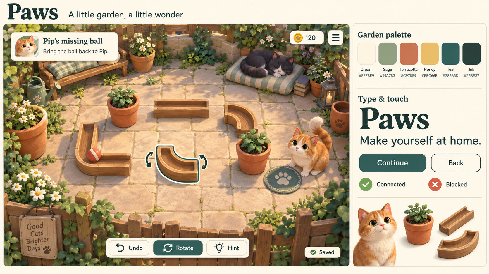

# Paws visual design

Design direction, 10 October 2026. This guide defines the intended graphics, colour, lighting, typography and GUI for the garden game in [paws-concept.md](paws-concept.md). It complements the proposed [game architecture](architecture.md); the delivered game remains the greybox integration foundation described in [README.md](README.md) and [docs/architecture.md](docs/architecture.md). The artwork below is concept work, not evidence of implemented gameplay or browser rendering.

## 1. Direction: a sunlit miniature garden

Paws should feel like tending a small, well-loved garden with cats who have made it their home. Build a tactile, softly sculpted 3D world: warm paving, painted wood, rounded terracotta pots, cotton cushions and clumps of sage foliage. Give the interface the quiet character of cream stationery with evergreen ink. The cats and their small problems are the focus.

The emotional tone is affectionate, curious and unhurried. Two-to-five-minute puzzles should feel inviting to examine and satisfying to understand. Friendship, useful garden furnishings and the cats' reactions provide the celebration.

| Principle | Visible result |
| --- | --- |
| Read the puzzle first | Open ground around movable pieces; clear channels, sockets and destinations. |
| Feel the materials | Broad wood grain, softened ceramic edges and simple fabric folds. |
| Let cats carry the personality | Distinct coat markings, silhouettes, ear poses and restrained reactions. |
| Keep the garden calm | Moderate saturation, soft shadows, little ambient movement and compact controls. |
| Make every action understandable | Selection, legal destinations and consequences use shape, text and colour together. |

Avoid glossy plastic, jagged low-poly silhouettes, photorealistic surface noise, neon accents, heavy black outlines, busy particle effects and a screen full of meters. Do not add an energy bar, countdown or urgency animation to these relaxed puzzles.

## 2. Reference image

[Open the full reference image](docs/design/paws-style-reference.png).

The board combines a proposed **Pip's missing ball** scene with an illustrative GUI, palette and type treatment. Follow its warm/cool balance, material families, open puzzle area, rounded shapes and cream/teal interface hierarchy. The outer title and right-hand style rail are presentation material, not in-game panels.

The document's hex values, type choices and interaction rules take precedence over generated pixels. The image is not a mechanically validated puzzle layout; decorative text is not approved game copy. Simplify its individual fur strands, dense leaves, fine stone texture and small props for production. The game uses sculpted coat masses and grouped foliage. The illustrated font shapes are approximations, not proof that the specified fonts were rendered.

## 3. Graphics and shape language

### World and camera

Use stylized 3D with soft bevels and clean, rounded silhouettes. Keep broad surfaces simple and concentrate detail at recognisable edges: a pot rim, a channel lip, a basket handle. Slight asymmetry gives props character, but gameplay footprints and connections remain precise.

Frame puzzles from an elevated three-quarter view with mild perspective. Start camera studies around 40–50 degrees above the ground and a 30–40 degree vertical field of view; fit the playable bounds separately for each aspect ratio. These are art starting points, not required engine settings. Keep the entire relevant route and destination legible. Avoid shallow depth of field, camera roll and perspective that hides sockets behind pots.

Place garden decoration around the puzzle perimeter and in low background layers. Use low planting at the front and taller hedges behind. Author camera limits and foreground height so a fence, cat or leaf cannot conceal a legal target. Paving seams should be quieter than puzzle edges and should not imply false movement cells.

### Cats

Use one compatible rig with softly rounded bodies, broad paws, triangular ears, short muzzles and substantial tails. Heads can be gently enlarged for expression while the silhouette remains unmistakably feline. Model fur as smooth masses with a few silhouette tufts; avoid strand fur as a baseline requirement. Keep eyes readable without making them enormous or glassy.

These are proposed character treatments, not existing assets:

| Cat | Coat and silhouette | Character through presentation |
| --- | --- | --- |
| Pip | Ginger tabby, cream muzzle/chest, upright curved tail | Curious lean, quick ear turn, short happy pounce. |
| Mabel | Cool grey tabby, broad cream chest, relaxed tail | Slow blink, composed sit, deliberate stretch. |
| Button | Charcoal coat, cream muzzle/paws, compact curled silhouette | Small peeks, tucked paws, contented curl-up. |
| Pepper | Cream and dark patches, distinctive asymmetric face marking | Attentive head tilt, lively ear poses, gentle tail flick. |

Keep identity consistent across 3D models, portraits and dialogue. A name and face marking distinguish cats even when coat colours look similar. Dark coats retain visible facial planes in shade. Share geometry/rigging where useful; do not introduce incompatible proportions merely for a coat variant.

### Props and materials

| Family | Surface treatment | Gameplay readability |
| --- | --- | --- |
| Pots and planters | Matte terracotta, thick rims, subtle broad mottling | Movable pots expose their base and slide direction; decorative pots sit outside the play area. |
| Channels and planks | Warm pale wood, broad grain, rounded lips | Endpoints and connections remain unobstructed; grain never resembles route arrows. |
| Crates and gates | Slightly darker wood, chunky slats, minimal hardware | Gate state changes silhouette and opening, not just tint. |
| Baskets and cushions | Simplified woven bands, matte cloth, broad seams | Socket shapes and occupied areas remain visible under objects. |
| Bowls and water | Satin ceramic, flat readable water surface | Fill line and a symbol communicate state without relying on reflections. |
| Ball and toys | Coral ball with cream band; mouse with distinct ears/tail | Contrast against wood and stone; each toy keeps a unique silhouette. |
| Foliage and ground | Grouped opaque leaf volumes, quiet sandstone | Lower visual contrast than cats and interactive objects. |

Use predominantly nonmetallic materials. Suggested roughness starting ranges: clay/stone/cloth 0.75–0.95, wood 0.60–0.85, glazed bowls 0.35–0.55. Tune in the actual renderer; these values are not a guarantee of matching the generated image. Reserve reflective highlights for tiny accents. Avoid baked directional cast shadows in base colour; movable pieces must remain believable when rotated.

## 4. Colour system

Keep roughly two-thirds of the visible world in quiet greens, stone and cream. Let terracotta/wood provide warmth and reserve stronger accents for toys, interactions and rewards. This is a composition guide, not a pixel quota.

Hex values are sRGB authoring values. Convert through the rendering pipeline correctly; do not assume a lit material will display its base-colour hex unchanged.

| Token | Value | Role |
| --- | --- | --- |
| `cream` | `#FFF8E9` | Opaque GUI panels, light button text and bright selection halo. |
| `linen` | `#E8DDC7` | Inset backgrounds and quiet decorative dividers. |
| `sage` | `#91A783` | Main foliage family and secondary decorative fills. |
| `moss` | `#627A57` | Plant shadows and deeper landscape accents. |
| `terracotta` | `#C97859` | Pots, warm decorative accents and selected character details. |
| `honey` | `#EBC66B` | Coin fills, small reward details and warm focus accents. |
| `teal` | `#28665D` | Primary buttons, selection edges and active controls. |
| `ink` | `#253E37` | Primary text, icons and functional dark outlines. |
| `muted-ink` | `#59685B` | Secondary readable text on cream. |
| `sky` | `#BFD9DD` | Cool ambient colour family and quiet blue ceramics. |
| `coral` | `#D86D55` | Toy ball and small attention accents. |
| `error-ink` | `#A94335` | Blocked-state text/cross and error border on cream. |

Use ink on cream for ordinary text, cream on teal for the main action, and ink on honey for rewards. Calculated flat-colour contrast is approximately 10.9:1 for ink/cream and 6.3:1 for cream/teal. Muted-ink/cream and error-ink/cream also exceed the project's 4.5:1 normal-text target. Recheck composited states in the actual GUI.

Terracotta, sage and honey are decorative colours, not small text colours on cream. Do not put cream text on the terracotta token. Selection uses a teal edge plus a cream halo so it remains visible over both dark grass and pale paving. Functional boundaries should reach the project's 3:1 contrast target against their adjacent fill; linen alone is only a decorative divider.

Puzzle meaning never depends on red versus green. Pair success with a check/connected shape, blocked actions with a cross and explanation, switches with up/down geometry, and matching slots with distinct silhouettes or symbols.

## 5. Lighting

The default garden is a gentle late afternoon, with a warm directional key and cool ambient fill. Light should separate surfaces without bathing everything in orange. Cream panels remain neutral and are drawn independently of world lighting.

| Element | Art direction |
| --- | --- |
| Sun | One directional source, roughly 35–50 degrees elevation; default framing places it toward the upper left. |
| Key/fill balance | Begin with a roughly 2:1 perceived lit-to-shadow balance; preserve detail in dark coats and under props. |
| Shadows | Short to medium, soft where supported, with stable contact at paws and pot bases. Keep puzzle junctions readable. |
| Ambient | Cool sage-blue influence; never fully black unlit faces. |
| Exposure | Stable within a puzzle; no adaptation jumps while selecting or rotating objects. |
| Post-processing | No required bloom, volumetric rays, film grain, depth of field, chromatic aberration or motion blur. |
| Water | Simple tinted surface/ribbon and controlled highlight; no real-time reflection requirement. |

Use engine-supported lighting and material controls to approximate this direction; the reference is not a demand for additional light types or global illumination. A warm dusk palette can be explored later for garden ambience, but puzzle visibility and semantics must remain identical. Do not introduce a day/night cycle as part of this guide.

On the mobile baseline, the design must work without shadow maps. Use a restrained ground-contact marker/blob where needed, readable base colours and material contrast. Desktop may use the architecture's single directional shadow map. Keep contact effects from stacking into dark halos. Shadow-free presentation must not change legal moves or obscure depth cues.

## 6. Typography and icons

Use **Fraunces Semibold (600)** for the Paws wordmark, screen titles and short quest headings. Its soft serif forms bring a storybook character. Use **Nunito Sans Regular (400) and Semibold (600)** for dialogue, instructions, prices, buttons and settings. Keep body text upright and reserve the display face for short text.

Both families are distributed in the Google Fonts repository with SIL Open Font License 1.1 records: [Fraunces font source](https://github.com/google/fonts/tree/main/ofl/fraunces), [Fraunces license](https://github.com/google/fonts/blob/main/ofl/fraunces/OFL.txt), [Nunito Sans font source](https://github.com/google/fonts/tree/main/ofl/nunitosans), [Nunito Sans license](https://github.com/google/fonts/blob/main/ofl/nunitosans/OFL.txt). Checked 10 October 2026. Font binaries have not been added by this design task.

| Use | Desktop starting size | Narrow-screen starting size | Weight |
| --- | --- | --- | --- |
| Title screen wordmark | 56–72 px | 40–48 px | Fraunces 600 |
| Screen/dialog title | 28–32 px | 24–28 px | Fraunces 600 |
| Quest heading | 22–24 px | 20–22 px | Fraunces 600 |
| Dialogue and instructions | 18 px | 17–18 px | Nunito Sans 400 |
| Buttons and prices | 16–18 px | 16–18 px | Nunito Sans 600 |
| Supporting status | 14–16 px | 14–16 px | Nunito Sans 400 |

Sizes are logical CSS-pixel equivalents, independent of render resolution. Use 1.4–1.5 line height for body copy and around 1.15 for headings. Avoid all-caps paragraphs, thin weights and condensed labels. Allow text wrapping, larger text and longer translations without shrinking below the listed sizes.

Bundle selected font files locally during implementation, with copyright/license records and required language coverage. Prefer tested static instances for engine font import if variable-font axes are unsupported. The HTML shell uses the same family choices, with Georgia and system sans-serif as readable fallbacks. Verify accented characters including Å, Ä and Ö and the actual engine font atlas before approval.

Draw an original icon family on a 24-unit grid: rounded caps, approximately 2-unit strokes and clear silhouettes. Use arrows for undo/rotation, a simple bulb for hint, a paw for friendship, a coin for currency and a home for garden. Functional icons normally accompany text. Give icon-only menu/close controls accessible names. Do not use platform emoji as shipped GUI icons.

## 7. GUI construction and states

Use opaque cream surfaces, restrained ink-coloured shadows and moderate rounding. The interface should feel like a small set of garden labels, without simulated torn paper, heavy wood frames or ornamental paw prints on every control.

| Property | Starting token |
| --- | --- |
| Spacing scale | 4, 8, 12, 16, 24, 32 logical px |
| Standard control height | 48 px; no action target below 44 by 44 px |
| Target separation | At least 8 px |
| Button radius | 12 px |
| Card radius | 16 px |
| Card padding | 16–24 px |
| Functional border | 2 px, contrasted with its adjacent surface |
| Shadow | Ink at about 12% opacity, 4 px downward offset, restrained softness |
| Modal backdrop | Ink at approximately 35–45%; panel stays opaque |
| Focus | 3 px teal ring with 2 px cream separation; visible outside the control |

If the renderer lacks soft GUI shadows, use a simple offset underlay. No background blur is needed. Tokens are shared visual targets for engine GUI and browser startup/recovery screens.

| State | Required treatment |
| --- | --- |
| Primary action | Teal fill, cream label, one visually dominant action per panel. |
| Secondary action | Cream fill, ink label/border. |
| Hover | Slight tonal shift and stronger edge; every action still works without hover. |
| Pressed | Darker fill/edge and at most 1–2 px visual inset; stable target bounds. |
| Keyboard focus | Explicit contrasting outer ring; do not rely on the hover state. |
| Selected/toggled | Teal indicator plus check or state label. |
| Disabled | Linen fill, readable muted label, inactive semantics; explain why when relevant. |
| Invalid action | Error-ink cross and short reason, such as “The pot is in the way.” |
| Busy | Specific label such as “Loading garden…”; keep text legible and prevent duplicate activation. |

Use friendly, concrete action labels: “Rotate”, “Place”, “Undo”, “Hint”, “Back to garden”. Hints reveal progressively and do not penalise the player. Example quest copy: **Pip's missing ball** / “Bring the ball back to Pip.” Avoid technical identifiers and raw errors in normal play.

## 8. Screens and responsive layout

### Garden

Keep the garden dominant. A compact top strip contains coins, a contextual friendship indicator and menu access. A small lower navigation group opens Cats, Shop and placement when available. Quest markers attach to the relevant cat, with a short label on selection. Avoid a permanent full quest sidebar.

### Puzzle

On wide layouts, place a compact quest card at the upper left, small menu/currency controls at the upper right, and the action tray along the bottom. The selected object gets a name and context actions such as Rotate or Move. Undo and Hint remain easy to find; Restart sits in the pause menu with a clear confirmation. Keep reset-view access available. Garden-only shopping controls are hidden during a puzzle.

Aim to leave at least 70% of the wide scene unobstructed during ordinary play. This is a layout goal, not a reason to compress readable text. The playable bounds must remain above the action tray and outside the quest card's rectangle.

On a roughly 390 × 844 portrait viewport, use a short top objective strip, a reframed scene in the middle, and a bottom action area with no more than two rows. Move currencies into the menu during a puzzle when space is tight. Let the player expand the objective/hint in a sheet, then return to the unobstructed board. Reserve space for safe-area insets and browser chrome. Portrait must remain usable without rotating the device.

Reflow by available space rather than shrinking a desktop screenshot. At intermediate widths, collapse secondary text before reducing the board. The same logical puzzle uses separately authored camera framing for portrait and landscape. Larger text can expand a panel or make its content scroll; it must not push close/back controls off-screen.

### Dialogue, completion, shop and placement

| Surface | Structure and treatment |
| --- | --- |
| Cat dialogue | Small portrait, name, one short paragraph, visible continue/close. Entire text can appear immediately; no forced typewriter delay. |
| Completion | Cat reaction followed by a compact cream card with the actual coin/friendship reward and “Back to garden”. No fabricated ratings or compulsory celebration delay. |
| Shop | Clear category controls, item preview, name, price and state: locked, available or owned. Selecting opens details before purchase. |
| Placement | Clear footprint preview; check for valid, cross plus reason for invalid. Explicit Place/Cancel controls. |
| Pause/settings | Continue, Restart puzzle, Back to garden and settings. Sound, motion, text size and quality controls have labels and visible values. |
| Save status | Quiet “Saving…” then “Saved” only after persistence succeeds. Persistent readable failure with Retry; never a false success check. |
| Startup/recovery | Cream HTML surface with real progress/status, readable compatibility or recovery explanation, and an actionable retry where appropriate. |

Open overlays capture input and expose a clear way back. Modal focus stays inside the modal and returns to the initiating control on close. Visible modal state and the application's simulation pause policy must agree.

## 9. World interaction and motion

| Situation | Visual language |
| --- | --- |
| Available object | Readable shape; subtle affordance on focus/selection, not permanent pulsing on every prop. |
| Selected object | Thin teal contour/ground marker with cream contrast edge, plus object name and explicit actions. Use a marker if outlines are unavailable. |
| Legal move | Discrete destination shape and directional arrow; show one clear preview. |
| Connected route | A short trace through the actual valid connections, endpoint symbol and “Connected” feedback where helpful. |
| Blocked move | Stationary committed object, cross on rejected destination, specific short explanation. |
| Active switch | Depressed shape and check; gate visibly opens. |
| Matching socket | Outline of the required toy/shape; occupied state remains identifiable. |
| Bell sequence | Distinct symbols and an on-screen sequence corresponding to the audible clue. |

Tap-to-select and explicit actions are the baseline. Optional dragging must have a clear preview and cancellation state. No task requires hover, precise dragging or sound. The GUI offers a keyboard-accessible object/action list alongside world selection, with useful names such as “Curved channel” and “Left planter”.

Suggested motion timings: button feedback 80–120 ms, panel entry 160–220 ms, prop movement/rotation 200–350 ms, short success reaction 600–900 ms. Use gentle ease-out without elastic overshoot. Logical results do not wait for an animation to decide them.

Reduced motion removes camera sweeps, idle swaying, reward bursts and large transitions. Replace movement with immediate state updates or a short opacity transition while preserving the same labels and result. Avoid camera shake and flashes. Cat animation should be sparse enough that a moving tail does not repeatedly obscure a puzzle target.

## 10. Production scope and acceptance

Start with the art kit needed by quests 1, 6 and 7: canonical cat rig and portraits, ball, pots, channels, basket, toy shapes, blocking cushion, switch and gate. Add one garden ground/edge kit and the reusable GUI components before expanding the decoration catalogue. Produce one representative puzzle composition in wide and portrait layouts before scaling asset production.

Follow [architecture.md, rendering and performance policy](architecture.md#12-rendering-and-performance-policy). Its triangle, texture, draw-call, memory and startup budgets remain provisional targets. Reuse meshes, materials and coat variants; keep opaque foliage and transparent effects bounded. The design must read at the mobile quality setting without expensive lighting features. No generated artwork demonstrates achievable frame rate or physical-device support.

Paws owns the art, palettes, GUI composition and game-specific behaviour. Engine improvements remain reusable WebEngine work. Use engine GUI for in-game menus/HUD and HTML for startup/recovery as proposed by the architecture. This document adds no new runtime dependency or build-boundary change.

Before accepting an implementation, review:

- The actual built game at desktop, narrow portrait and short landscape sizes, with larger text and touch-sized targets.
- Cat identity, route endpoints and legal targets at ordinary play scale, including a grayscale review and the shadow-free quality setting.
- Default, hover, focus, pressed, selected, disabled, invalid and loading states; measure text and functional-edge contrast after rendering.
- One complete puzzle using mouse, touch and keyboard-equivalent commands, plus reduced motion and sound-independent clues.
- Dialogue, completion, shop, placement, pause, save failure and recovery for readable copy and consistent visual hierarchy as those features are delivered.
- Actual font rendering, accented glyphs, material appearance, resource budgets and physical-device performance before claiming production acceptance.

This delivery is a design document and generated reference image. No runtime code changed, so browser builds or scene tests were not required for this documentation task. Implementation and device acceptance remain future work.

## 11. Reference provenance

| Field | Record |
| --- | --- |
| Asset | `docs/design/paws-style-reference.png` |
| Created | 10 October 2026 |
| Method | OpenAI built-in image generation tool; generated from text for this project. |
| Inputs | Original direction in this document and the repository's garden-puzzle concept; no external reference images. |
| Exact generation prompt | [reference-prompt.txt](docs/design/reference-prompt.txt) |
| Intended use | Art direction and GUI reference; not a runtime texture, font specimen or validated level. |
| Rights record | AI-generated output; no third-party asset license is asserted or attached. Font sources have their separate OFL records above. |
| Packaging | Kept under `docs/design/` so the game's current blanket `assets/` staging does not ship the reference board. |

For each future imported model, texture, font and sound, record the source, creator, license and any modifications with the asset. Retain editable production sources and use this guide to review them together in the game.
